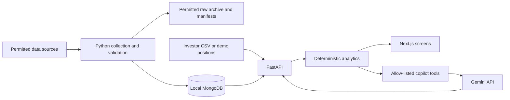

# FOLIO Architecture and Dependencies

## Components

- Next.js, TypeScript, Tailwind CSS and Recharts provide responsive application screens.
- One FastAPI application owns authentication, portfolio APIs, calculations, insights and Gemini orchestration.
- PyMongo connects to local MongoDB Community Server. Atlas is not required.
- Pandas, NumPy and SciPy support normalization and numerical analytics.
- Python command-line scripts collect and validate provider data; no worker or scheduler is required for the POC.
- Docker Compose may be offered as an optional local convenience after native startup works.

No PostgreSQL, SQLAlchemy, Alembic, Redis, Celery, Kafka, vector database, LangChain, or microservices are part of the design.

## Data flow

## MongoDB design

Collections: `users`, `sessions`, `portfolios`, `holdings`, `instruments`, `prices`, `corporate_actions`, `fund_schemes`, `fund_navs`, `fund_snapshots`, `fund_constituents`, `benchmarks`, `benchmark_values`, `ingestion_jobs`, `data_manifests`, `insights`, `conversations`.

Use Decimal128 or integer minor currency units for financial values. Index owner and lookup fields. Unique keys: provider/instrument/date; scheme/NAV date; scheme/disclosure/security; benchmark/date. Store disclosure reporting and publication dates separately. Keep a versioned, idempotent Python setup script for indexes and schema version.

## API and security

All routes use `/api/v1`. Groups: auth; portfolio/holdings; import preview/confirm; instrument search/data health; analytics summary/allocation/exposure/overlap/risk/benchmark; insights; copilot chat/history. Enforce portfolio ownership in every query and mutation. Validate uploads and file size. Hash passwords with Argon2; use HttpOnly session cookies and environment secrets. Do not return or log credentials.

`.env.example` contains variable names only, including `GEMINI_API_KEY`; actual `.env` is untracked. Rotate the Gemini key previously pasted into chat before use. Limit Gemini requests and provide deterministic fallback.

## Copilot tools

The backend may expose `get_summary`, `get_allocation`, `get_exposure`, `get_overlap`, `get_risk`, `get_benchmark`, `get_insights`, and `get_data_health`. Build context for the authenticated portfolio only. Check generated numbers against tool output and attach relevant dates, coverage, and sources. Unsupported questions explain the available data gap.
